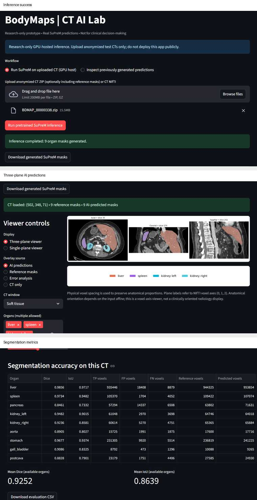
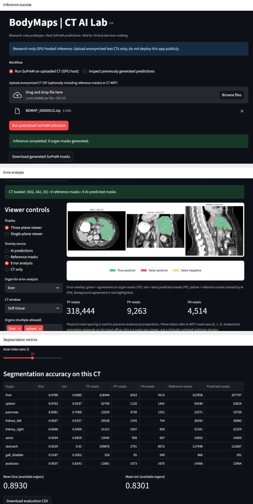
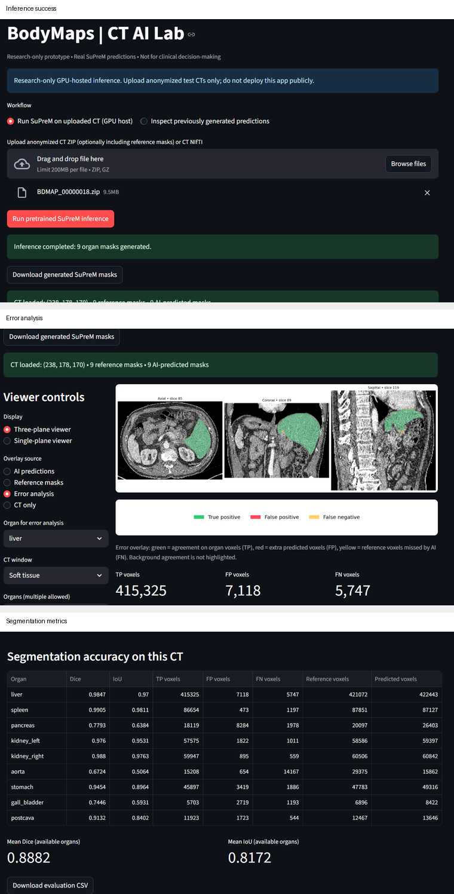

# BodyMaps | CT AI Lab

**Research-only prototype. Not for clinical decision-making.**

BodyMaps | CT AI Lab is a Streamlit research application for **browser-triggered multi-organ CT segmentation** with the pretrained [SuPreM](https://github.com/MrGiovanni/SuPreM) U-Net.

A user uploads an anonymized CT, clicks **Run pretrained SuPreM inference**, and the application launches real GPU inference, returns nine organ masks, displays them in axial/coronal/sagittal views, and—when reference masks are supplied—computes Dice, IoU, TP, FP and FN.

## What this prototype demonstrates

- Browser upload of an anonymized CT ZIP or NIfTI.
- Real SuPreM GPU inference triggered from the Streamlit interface.
- Nine generated organ masks: liver, spleen, pancreas, left/right kidney, aorta, stomach, gall bladder and postcava.
- Three-plane and single-plane CT visualization.
- AI prediction, reference-mask and voxel-error overlays.
- Per-organ Dice/IoU plus TP/FP/FN counts when references are available.
- Downloadable generated-mask ZIP and evaluation CSV.
- Strict **name-based** checkpoint loading rather than positional tensor assignment.
- SHA-256 checkpoint verification before `torch.load`.

## Verified technical configuration

The demonstrated workflow ran in Google Colab on an NVIDIA Tesla T4 using:

- Python 3.9.25
- PyTorch 1.11.0+cu113
- MONAI 0.9.0
- NumPy 1.24.4
- Streamlit 1.49.1
- SuPreM commit `3e729951c61f729cd2fa6ceefa8e021bcfcd4985`

Checkpoint:

`supervised_suprem_unet_2100.pth`

Verified SHA-256:

`c8dc39c86cd8d715e5ef0b5bb4ba4335ba45237127829ea016f75ee8beca0a93`

The strict checkpoint audit matched **117 model tensors to 117 checkpoint tensors**, with no missing, unexpected, duplicate-normalized, shape-mismatched or dtype-mismatched entries.

## Browser workflow validation

Three anonymized BodyMaps/AbdomenAtlas cases with different CT geometries completed the full browser-triggered workflow:

| Case | CT shape | Generated organs | Mean Dice | Mean IoU |
|---|---:|---:|---:|---:|
| `BDMAP_00000338` | `(502, 348, 71)` | 9 | **0.9252** | **0.8639** |
| `BDMAP_00000015` | `(502, 342, 33)` | 9 | **0.8930** | **0.8301** |
| `BDMAP_00000018` | `(238, 178, 170)` | 9 | **0.8882** | **0.8172** |

These are **functional demonstration results**, not a held-out scientific benchmark. Training/pretraining overlap for these cases has not been established, so they should not be interpreted as independent generalization performance.

The machine-readable summary is in [`results/validation_summary.csv`](results/validation_summary.csv).

## Demonstration screenshots

The galleries below capture the actual browser workflow used for the three validation cases. Each combines the successful inference state with the corresponding visualization/error-analysis and evaluation output.

### BDMAP_00000338 — full browser inference and prediction viewer



**Observed result:** 9 generated organ masks, mean Dice **0.9252**, mean IoU **0.8639**.

### BDMAP_00000015 — inference, error analysis and metrics



**Observed result:** 9 generated organ masks, mean Dice **0.8930**, mean IoU **0.8301**.

### BDMAP_00000018 — inference, error analysis and metrics



**Observed result:** 9 generated organ masks, mean Dice **0.8882**, mean IoU **0.8172**.


## Architecture

```text
Browser / Streamlit
       |
       | upload CT + click inference
       v
inference_backend.py
       |
       | isolated subprocess
       v
audited SuPreM direct inference (GPU)
       |
       v
9 NIfTI organ masks
       |
       +--> downloadable ZIP
       +--> CT overlays
       +--> reference comparison / CSV
```

## Reproducibility and checkpoint audit

See [`INFERENCE.md`](INFERENCE.md) for the verified environment, checkpoint hash, strict name-based loading approach, browser subprocess path and demonstrated cases.

The pretrained model checkpoint and CT datasets are intentionally **not distributed** in this repository.

## Required runtime variables

```text
SUPREM_REPO=/path/to/SuPreM
SUPREM_CHECKPOINT=/path/to/supervised_suprem_unet_2100.pth
SUPREM_PYTHON=/path/to/suprem_env/bin/python
BODYMAPS_REPORT_DIR=/path/to/private/reports
```

Important: `SUPREM_PYTHON` must remain the virtual-environment interpreter path itself. The browser integration deliberately does **not** call `Path.resolve()` on this path because resolving the venv symlink can select the base Python interpreter and bypass the environment containing PyTorch/MONAI.

## Repository files

- [`app.py`](app.py) — Streamlit viewer, evaluation UI and inference trigger.
- [`inference_backend.py`](inference_backend.py) — browser-to-SuPreM subprocess bridge and upload validation.
- [`INFERENCE.md`](INFERENCE.md) — audited inference setup and provenance.
- [`requirements.txt`](requirements.txt) — verified web/viewer dependencies.
- [`results/validation_summary.csv`](results/validation_summary.csv) — three-case browser validation summary.
- [`screenshots/`](screenshots/) — three case galleries documenting inference, visualization/error analysis and metrics.
- [`.gitignore`](.gitignore) — prevents CT data, checkpoints and runtime logs from being committed.

## Security / deployment scope

This is a research prototype, **not a public medical service**. It includes upload-size limits, ZIP path checks, exact CT-file selection, temporary request directories, fixed-checkpoint inference, required-output validation, and private server-side inference logs.

It does **not** provide production-grade authentication, authorization, PHI governance, concurrency control, autoscaling or clinical validation. Use anonymized research/test CTs only.

## Limitations

- Not for clinical use.
- The viewer preserves physical voxel spacing but is not a clinically oriented radiology workstation.
- Sliding-window overlap is `0.25`, matching the demonstrated feasibility workflow.
- The three cases establish application functionality across different CT geometries, not scientific generalization.
- No claim of Johns Hopkins affiliation, program acceptance or clinical validation is made.
